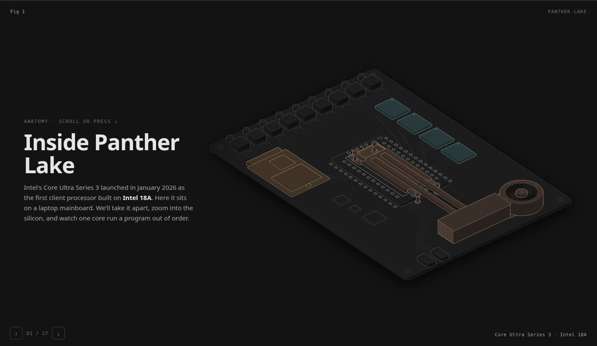
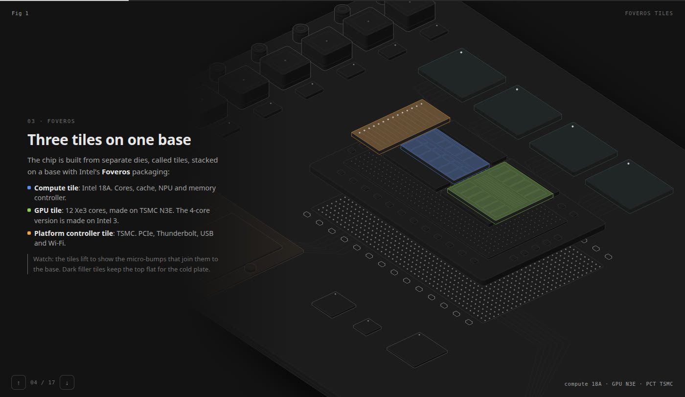
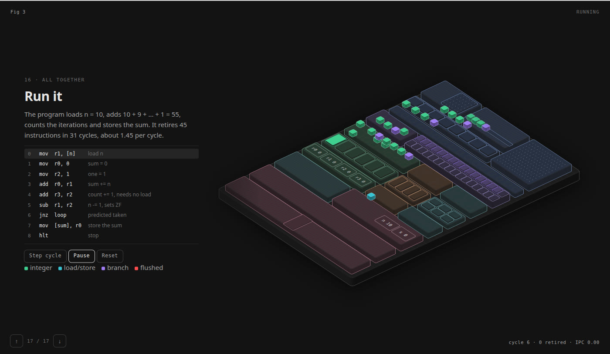

# Inside Panther Lake

A scroll-driven teardown of Intel's Core Ultra Series 3 (Panther Lake). It starts at the laptop mainboard and zooms in to a single Cougar Cove P-core running a real program out of order, one cycle at a time.

**[▶ Open it live](https://cpu-anatomy.vercel.app)** · [light theme](https://cpu-anatomy.vercel.app/cpu-light.html) · [sources](https://cpu-anatomy.vercel.app/sources.html)

https://github.com/user-attachments/assets/a8eb51da-9c22-442e-b3cc-b2639d07fa9b

## What you'll see

17 slides, each one zooming in further:

| | |
|---|---|
|  | **Board → package.** The cooling module lifts off, and the package splits into its three Foveros tiles: compute (Intel 18A), GPU (TSMC N3E) and platform controller (TSMC). |
|  | **Compute tile → P-core.** P-cores, E-cores, the cache ring, the NPU and the memory interface, then one P-core's floorplan drawn to Lion Cove's published proportions. |
|  | **The core runs a program.** Micro-ops move as colored tokens through the front end, the reorder buffer and the ports. The loop branch mispredicts on its last iteration and the pipeline flushes. |

## The simulator

`model.mjs` is a small cycle-based model of the P-core that drives the last slides:

- 8-wide decode, rename and retire
- 576-entry reorder buffer
- Ports: 6 integer, 4 vector, 3 load, 3 store
- Register renaming, oldest-first scheduling, an L0/L1 load latency, and branch prediction with flush on mispredict

It runs this loop, which sums 10 + 9 + … + 1:

```asm
loop:  add  r0, r1      ; sum += n
       add  r3, r2      ; count += 1
       sub  r1, r2      ; n -= 1, sets ZF
       jnz  loop        ; predicted taken
```

It retires 45 instructions in 31 cycles, an IPC of about 1.45. It's a teaching model, not a reproduction of Intel's real microarchitecture.

## Run it locally

Open `index.html` (dark) or `cpu-light.html` (light) in any modern browser. They are self-contained, with no server and no install.

## Build from source

Requires Node.js 18+.

```bash
node build.mjs           # → index.html
node build.mjs --light   # → cpu-light.html
node model.test.mjs      # → model ok · 31 cycles · 45 retired · IPC 1.45
```

| File | Role |
|---|---|
| `slides.html` | Slide text |
| `build.mjs` | Draws every isometric scene and inlines everything into one HTML file |
| `floor.mjs` | P-core floorplan |
| `model.mjs` | Cycle-based out-of-order model |
| `live.js` | Scroll handling, animation and the simulator controls |
| `page.css` | Page styles |
| `vendor/iso-kit.mjs` | Isometric drawing kit (MIT, see `vendor/LICENSE-iso-kit`) |

## Sources

Figures come from public reporting: Chips and Cheese, ServeTheHome, Tom's Hardware, HotHardware and others. Core dimensions use Chips and Cheese's Lion Cove measurements. The full list is in [`sources.html`](sources.html).

---

Independent educational project. Intel, Core Ultra and Panther Lake are trademarks of Intel Corporation. This project is not affiliated with or endorsed by Intel.
