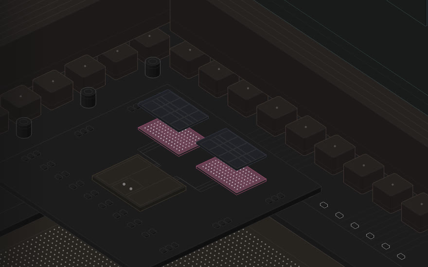
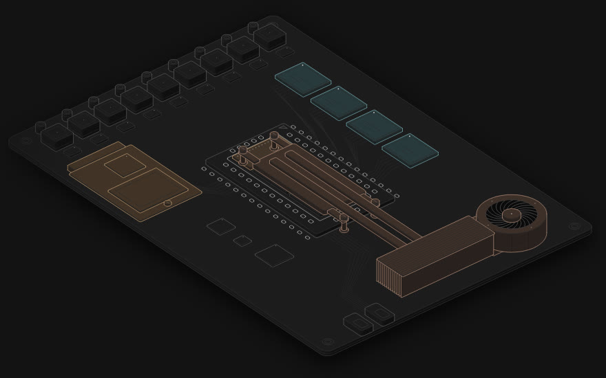
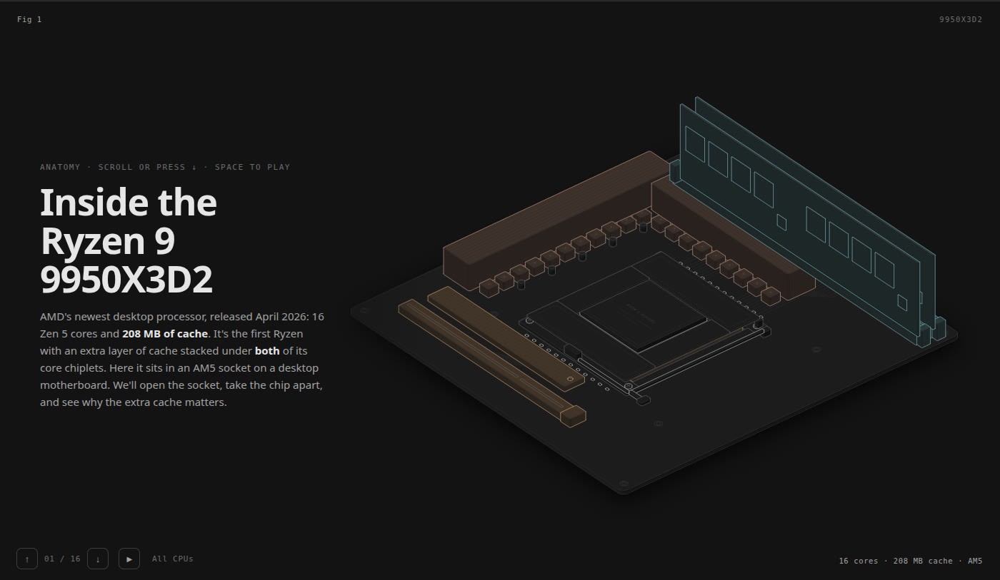
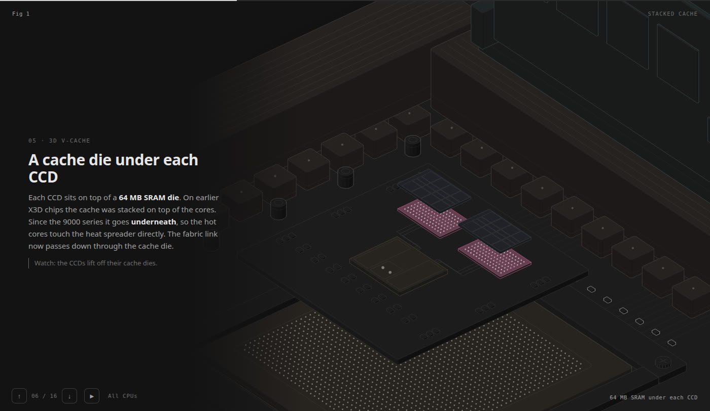
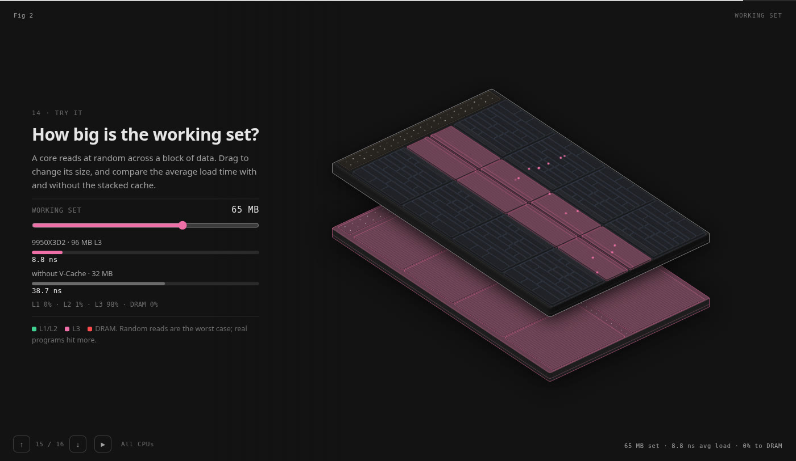

# CPU Anatomy

Interactive teardowns of real processors, drawn as detailed isometric machines. Each tour starts at the motherboard, takes the chip apart piece by piece, and zooms down to a single core doing real work.

**[▶ Open the site](https://cpu-anatomy.vercel.app)**, then pick a CPU.

https://github.com/user-attachments/assets/a8eb51da-9c22-442e-b3cc-b2639d07fa9b

## The tours

| | AMD Ryzen 9 9950X3D2 | Intel Core Ultra Series 3 (Panther Lake) |
|---|---|---|
| |  |  |
| Machine | Desktop, AM5 socket, 2026 | Laptop, soldered BGA, 2026 |
| Story | Socket → package → stacked 3D V-Cache → one CCD → one Zen 5 core | Cooler → Foveros tiles → compute tile → one Cougar Cove P-core |
| Live demo | Working-set explorer: drag a slider and watch loads land in L1, L2, L3, the stacked cache or DRAM | Out-of-order simulator: a loop runs cycle by cycle, with a branch mispredict and a pipeline flush |
| Open | [dark](https://cpu-anatomy.vercel.app/ryzen-9950x3d2/) · [light](https://cpu-anatomy.vercel.app/ryzen-9950x3d2/light.html) · [autoplay](https://cpu-anatomy.vercel.app/ryzen-9950x3d2/?play) | [dark](https://cpu-anatomy.vercel.app/panther-lake/) · [light](https://cpu-anatomy.vercel.app/panther-lake/light.html) · [autoplay](https://cpu-anatomy.vercel.app/panther-lake/?play) |

### Ryzen 9 9950X3D2

| | |
|---|---|
|  | **Socket → package.** The load plate and lever lift, the 40 × 40 mm package comes out of its 1,718-contact socket, and the notched heat spreader lifts off two CCDs and the 6 nm I/O die. |
|  | **Stacked cache.** Each CCD lifts off the 64 MB SRAM die beneath it. This is the first Ryzen with V-Cache under both CCDs: 192 MB of L3 and 208 MB of cache in all. |
|  | **Try it.** With a 64 MB working set, a load averages 8.8 ns with V-Cache and 38.1 ns without it. Inside the core, toggle one or two threads on the two 4-wide decode pipes, then watch the 448-entry reorder buffer fill and the 14 pipes fire. |

### Panther Lake

| | |
|---|---|
|  | **Board → package.** The cooling module lifts off, and the package splits into its three Foveros tiles: compute (Intel 18A), GPU (TSMC N3E) and platform controller (TSMC). |
|  | **Compute tile → P-core.** P-cores, E-cores, the cache ring, the NPU and the memory interface, then one P-core's floorplan drawn to Lion Cove's published proportions. |
|  | **The core runs a program.** A cycle-based model (8-wide, 576-entry ROB) runs a loop that sums 10 + 9 + … + 1. It retires 45 instructions in 31 cycles, and the loop branch mispredicts on its last iteration. |

## Using it

- **Scroll** or use the **arrow keys** to move through the slides.
- Press **▶** or the **space bar** for autoplay: each slide stays a few seconds, then the tour moves on by itself. Scrolling or using the arrow keys takes control back.
- **♪** toggles calm background music: *Calm Space Music* by Clavier-Music, from Pixabay. Browsers only allow sound after a click, so the home page opens with a short welcome screen: **Enter** starts the music, and it carries on into whichever tour you open. Opened directly, a tour starts the music on your first click or key press. Muting is remembered.
- Every number is cited on the tour's last page. The Ryzen core figures come from AMD's Hot Chips 2024 Zen 5 talk; the rest come from Chips and Cheese and launch reviews.

## Project layout

```
index.html                 the CPU picker (site root)
panther-lake/              built tour: index.html (dark), light.html
ryzen-9950x3d2/            built tour: index.html (dark), light.html
src/
  shared/                  used by every tour
    deck.mjs               drawing helpers for the build scripts
    deck.css               slide, caption and nav styles
    play.js                autoplay
    ambient.js             background music player
    iso-kit.mjs            isometric drawing kit (MIT, see LICENSE-iso-kit)
  <tour>/                  one folder per CPU
    build.mjs              draws every scene and writes the self-contained page
    floor.mjs              floorplans for the die and core zoom levels
    model.mjs              the numbers, and the model the live demo runs
    model.test.mjs         self-check for the model
    live.js                scrolling, camera and the tour's demos
    slides.html            slide text
    sources.html           cited sources
assets/
  audio/                   the background music track
  img/                     screenshots for the picker and this README
  demo/                    the demo video and its poster
build.mjs                  builds every tour and runs every check
```

## Build

Requires Node.js 18+. The built pages are committed and self-contained, so you only need to build after changing something in `src/`.

```bash
node build.mjs             # builds every tour, dark and light, and runs each model check
```

To preview locally, run `python3 -m http.server 8000` and open http://localhost:8000. You can also open any built `.html` file directly.

### Adding a CPU

Make `src/<name>/` with the same files as an existing tour, and design its own scenes and demo in `build.mjs` and `live.js`. Then run `node build.mjs`, which writes `<name>/index.html` and `<name>/light.html`. Finally, add a card for it in the root `index.html`.

## Thanks

Music: [Calm Space Music](https://pixabay.com/music/search/calm%20space%20music/) by **Clavier-Music** on Pixabay, used under the Pixabay Content License. Thanks to Clavier-Music! This helps keep the creative spirit going.

---

Independent educational project, not affiliated with or endorsed by AMD or Intel. AMD, Ryzen, Intel, Core Ultra and Panther Lake are trademarks of their owners.
